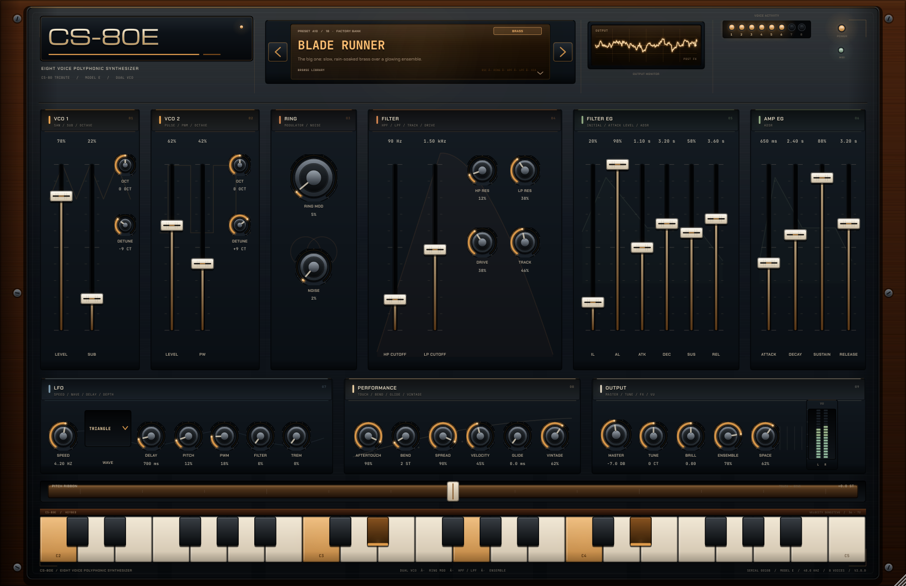
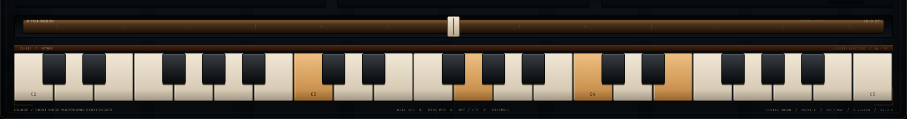

# CS-80E

### An eight-voice, dual-VCO CS-80 tribute — VST3 / AU / Standalone

[](https://github.com/boop-bip80/synth1/actions/workflows/ci.yml)
[](https://github.com/boop-bip80/synth1/releases/latest)
[](LICENSE)


<p align="center">
  
</p>

CS-80E is a from-scratch polyphonic synthesizer written in C++17 with JUCE. The
sound is a deliberately characterful take on the Yamaha CS-80 voice: two
band-limited oscillators with a sub-octave, a ring modulator, a resonant
high-pass into a resonant low-pass, the CS-80's two-level filter envelope,
polyphonic aftertouch, polyphonic portamento and a spring-loaded pitch ribbon.

Version 2.0 adds an anti-aliased analog drive stage, a nonlinear resonant filter
core, per-voice vintage drift and envelope variance, click-free voice stealing,
filter key tracking, master tune and a much larger 18-patch factory bank. The
panel has been rebuilt around the real instrument's language: graphite metal,
walnut cheeks, cream silkscreen, ivory fader caps, a chrome badge and warm amber
light.

The entire panel is painted in code — brushed metal, walnut, engraved lettering,
amber LEDs, a warm LCD and a phosphor scope. No bitmap skin, no external editor
dependency.

---

## Download the builds

The links below always point at the newest successful build on `main`:

| Platform | Download | Formats |
| --- | --- | --- |
| **Linux** | [CS-80E-linux.zip](https://github.com/boop-bip80/synth1/releases/latest/download/CS-80E-linux.zip) | VST3 + Standalone |
| **macOS** | [CS-80E-macos.zip](https://github.com/boop-bip80/synth1/releases/latest/download/CS-80E-macos.zip) | VST3 + AU + Standalone |
| **Windows** | [CS-80E-windows.zip](https://github.com/boop-bip80/synth1/releases/latest/download/CS-80E-windows.zip) | VST3 + Standalone |
| **Renders + demo** | [CS-80E-previews.zip](https://github.com/boop-bip80/synth1/releases/latest/download/CS-80E-previews.zip) | eight PNGs + demo WAV |
| **Checksums** | [SHA256SUMS.txt](https://github.com/boop-bip80/synth1/releases/latest/download/SHA256SUMS.txt) | SHA-256 |

Every push to `main` builds Linux, macOS and Windows, runs the headless suite,
renders the panel, validates the Linux VST3 with
[pluginval](https://github.com/Tracktion/pluginval), and refreshes the rolling
**latest** release. A `v*` tag also publishes a versioned GitHub Release.

### Install

- **Linux:** copy `VST3/CS-80E.vst3` to `~/.vst3/` (or run the standalone binary).
- **macOS:** copy `VST3/CS-80E.vst3` to `~/Library/Audio/Plug-Ins/VST3/`,
  `AU/CS-80E.component` to `~/Library/Audio/Plug-Ins/Components/`, or run the
  app from `Standalone/`.
- **Windows:** copy `VST3\CS-80E.vst3` to
  `C:\Program Files\Common Files\VST3\`, or run `Standalone\CS-80E.exe`.

The CI builds are unsigned. On macOS, right-click the plugin/app and choose
**Open** the first time. On Windows, allow the app through SmartScreen.

## Screenshots

| | |
| --- | --- |
|  |  |
|  |  |

<p align="center">
  
</p>

<p align="center">
  
  
</p>

CI renders these from the real editor at up to 2× resolution. On `main` it also
commits the refreshed images and demo back to `docs/`, and attaches them to the
latest release.

## Listen

[**cs80-demo.wav**](docs/audio/cs80-demo.wav) — 23 seconds of Blade Brass
chords and aftertouch swells, rendered offline through the real processor by the
screenshot tool.

## What is new in 2.0

- **A living analog voice path.** Anti-aliased cubic drive (ADAA) feeds a
  nonlinear state-variable filter, so high resonance compresses and blooms
  instead of turning brittle. Every voice has its own slow pitch drift, cutoff
  offset, level trim and envelope-time variance, all under the **Vintage**
  control.
- **Click-free voice stealing.** A stolen voice starts from its previous output
  sample and settles over a fraction of a millisecond, so dense chords never
  click when the ninth note arrives.
- **More of the CS-80 vocabulary:** sub-octave on VCO 1, polyphonic
  portamento, filter key tracking, filter drive and master tune.
- **A new 18-patch factory bank**, including Blade Runner, Tears in Rain,
  CS-80 Wind, Touch Bell, Velvet Strings, Prog Organ, Analog Bass and Neon Arp.
- **A completely redesigned panel:** graphite face, walnut cheeks, chrome
  CS-80E badge, cream slider caps, amber section rails, a warm glass LCD with
  bank/patch readout, numbered voice LEDs, a bronze ribbon controller and a
  two-column preset library.
- **Release automation:** stable per-OS download links, checksums, refreshed
  screenshots and a rolling latest release, all driven by GitHub Actions.

## What is inside

- **8-voice polyphony** with click-free oldest-voice stealing, a short declick
  handover and sustain-pedal handling.
- **Living voices:** every voice starts at a scattered phase and drifts a few
  cents at its own slow rate, so stacked chords breathe instead of phase-locking
  into one giant comb filter.
- **VCO 1:** band-limited polyBLEP saw, sub-octave square, ±2 octave switch,
  detune.
- **VCO 2:** band-limited polyBLEP pulse with DC-correct PWM, ±2 octave switch,
  detune.
- **Ring modulator** (VCO 1 × VCO 2) plus a noise source.
- **12 dB/oct high-pass and low-pass** filters in series, each resonant, with
  key tracking, an anti-aliased drive stage and a gently saturating low-pass
  core.
- **CS-80-style filter envelope** with Initial Level, Attack Level and A/D/S/R.
- **Amplitude ADSR**, velocity that opens the filter as well as the VCA, and a
  soft output limiter.
- **Polyphonic glide** from the last played note, plus master tune and per-voice
  vintage variance.
- **Buffer-size independence:** every glide is time-based and the filters and LFO
  update every eight samples, so the instrument sounds the same at any host
  block size.
- **LFO** (triangle / sine / square / saw) with delay and routings to pitch, PWM,
  filter and tremolo.
- **Expression:** channel and polyphonic aftertouch, mod wheel, pitch bend and a
  spring-loaded ribbon (±12 semitones) that you can play with the mouse.
- **Ensemble chorus**, plate reverb and a brilliance tilt on the output.
- **18 factory patches**, a two-column preset library, tooltips and
  double-click parameter reset.
- **Resizable UI** that keeps its hardware proportions from 1020×660 upward.

### The panel

| Section | What it does |
| --- | --- |
| **VCO 1 / VCO 2** | Mix saw/pulse and sub, set pulse width, switch octaves, detune. |
| **RING** | Blend the ring modulator and noise into the oscillators. |
| **FILTER** | HPF and LPF cutoffs, resonances, drive and keyboard tracking. |
| **FILTER EG** | IL/AL set the envelope's start and peak; A/D/S/R shape it. |
| **AMP EG** | Straight ADSR for the VCA. |
| **LFO** | Speed, waveform, fade-in delay, and four modulation depths. |
| **PERFORMANCE** | Aftertouch, bend range, stereo spread, velocity, glide and vintage. |
| **OUTPUT** | Master, tune, brilliance, ensemble and space, with a stereo meter. |
| **RIBBON** | Drag left/right for pitch; release to spring back. |
| **KEYBED** | Three octaves, velocity from the vertical touch point. |
| **LCD / LIBRARY** | Previous/next patch arrows; click the glass for the 18-patch library. |

## How the CI works

| Job | What it proves |
| --- | --- |
| `dsp-tests` | The engine builds and passes all headless checks without JUCE. |
| `build` | VST3 + Standalone compile on Linux, macOS and Windows (AU also on macOS); tests pass; zips are downloadable. |
| `screenshots` | The real editor is rendered offscreen to eight PNGs plus a demo WAV; refreshed renders are committed back to `main`. |
| `pluginval` | The Linux VST3 is validated by pluginval at strictness level 5. |
| `publish-latest` | Linux, macOS and Windows zips, checksums and previews are attached to the rolling `latest` release. |
| `release` | A `v*` tag publishes a versioned GitHub Release with all platform zips. |

Screenshots are generated by `Cs80Screenshots`, which instantiates the actual
plugin processor and editor, plays chords through the real MIDI path, and snaps
the component tree. Fonts are embedded, so the renderer is deterministic and
needs no system font packages.

## Build locally

Requirements: **CMake 3.22+**, a **C++17** compiler, and network access the first
time so CMake can fetch JUCE 8.

```bash
# Linux dependencies (Ubuntu/Debian)
sudo apt-get install -y build-essential cmake \
  libasound2-dev libx11-dev libxext-dev libxrandr-dev libxinerama-dev \
  libxcursor-dev libfreetype-dev libfontconfig1-dev libgl1-mesa-dev

cmake -S . -B build -DCMAKE_BUILD_TYPE=Release
cmake --build build --config Release --parallel

# Headless DSP suite
ctest --test-dir build -C Release --output-on-failure

# Panel screenshots + demo audio
./build/tools/Cs80Screenshots_artefacts/Release/Cs80Screenshots docs
```

Useful options:

```bash
-DCS80_BUILD_PLUGIN=OFF   # engine + tests only (no JUCE download)
-DCS80_BUILD_TOOLS=OFF    # plugin only, skip the offline renderer
-DCS80_BUILD_TESTS=OFF    # skip the unit test executable
```

The plugin targets are written to
`build/src/plugin/Cs80Plugin_artefacts/Release/`.

## Architecture

```
src/dsp/            Pure C++17 engine — no JUCE, fully unit-testable
  Params.*            parameter table + POD snapshot
  Dsp.h               polyBLEP oscillators, ADAA drive, nonlinear SVF,
                      segment envelopes
  Engine.*            8 vintage voices, glide, modulation, ensemble, plate reverb, master
  Presets.*           18 factory patches
  tests/              1,713 headless assertions

src/plugin/         JUCE wrapper
  PluginProcessor.*   APVTS, presets, MIDI dispatch, state persistence
  PluginEditor.*      panel layout and preset library wiring
  ui/                 theme, look and feel, hardware controls, scope,
                      meters, ribbon, keybed and preset browser

tools/screenshot/   Offline editor renderer + demo WAV
.github/workflows/  Build, test, screenshot, pluginval, latest and release pipeline
assets/fonts/       Embedded Chakra Petch, JetBrains Mono and Michroma (OFL)
docs/               Committed screenshots and the demo render
```

Designed boundaries: the engine never includes JUCE, so the full signal path can
run in a plain test binary on every platform. The JUCE layer only translates
parameters, MIDI and state, and paints the panel.

## Tests

The headless suite covers:

- parameter table integrity, ranges, defaults and every spec↔struct mapping;
- preset application, uniqueness and clamping across all 18 patches;
- silence when idle; finite output at every parameter extreme;
- 8-voice polyphony, click-free voice stealing with a declick handover;
- sub-oscillator tracking, polyphonic glide, master tune and vintage spread;
- identical rendering at 32- and 512-sample host block sizes;
- A4 tuning at 44.1, 48 and 96 kHz, octave switches and 24-semitone bend;
- filter brightness response, ring/chorus stereo behaviour and reverb decay;
- high drive/resonance stability, sustain pedal, retriggering, aftertouch/mod
  wheel and deterministic renders;
- every factory preset rendering with sane peak levels.

CI additionally builds the plugin on three operating systems and validates the
Linux VST3 with pluginval (`--strictness-level 5 --skip-gui-tests`).

## License

The project is licensed under **AGPL-3.0**. JUCE is used under its AGPLv3
option; see [LICENSE](LICENSE) and the [JUCE licensing page](https://juce.com/legal/juce-8-licence/).

Bundled fonts (Chakra Petch, JetBrains Mono, Michroma) are under the SIL Open
Font License 1.1; see [assets/fonts/OFL.txt](assets/fonts/OFL.txt).

CS-80 is a trademark of Yamaha Corporation. **CS-80E is an unofficial tribute and
is not affiliated with or endorsed by Yamaha.** All sound generation and UI
painting here is original code.

---

Built with C++17, JUCE 8, CMake and GitHub Actions.
