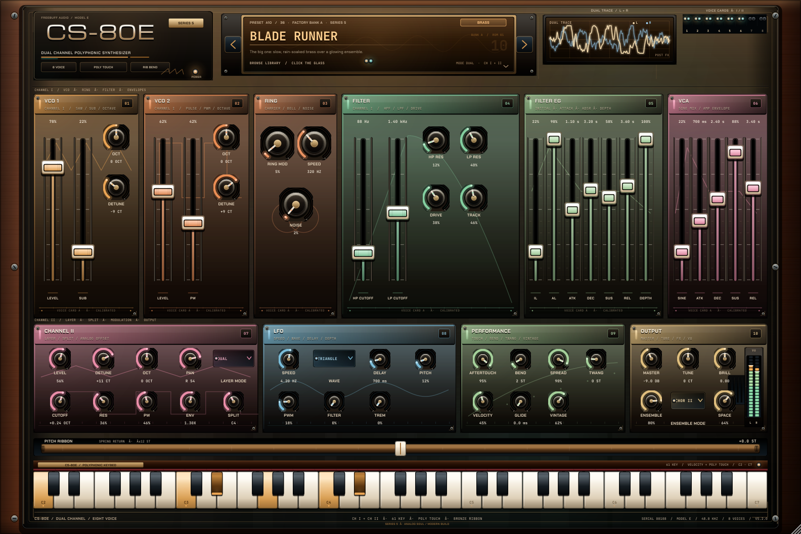
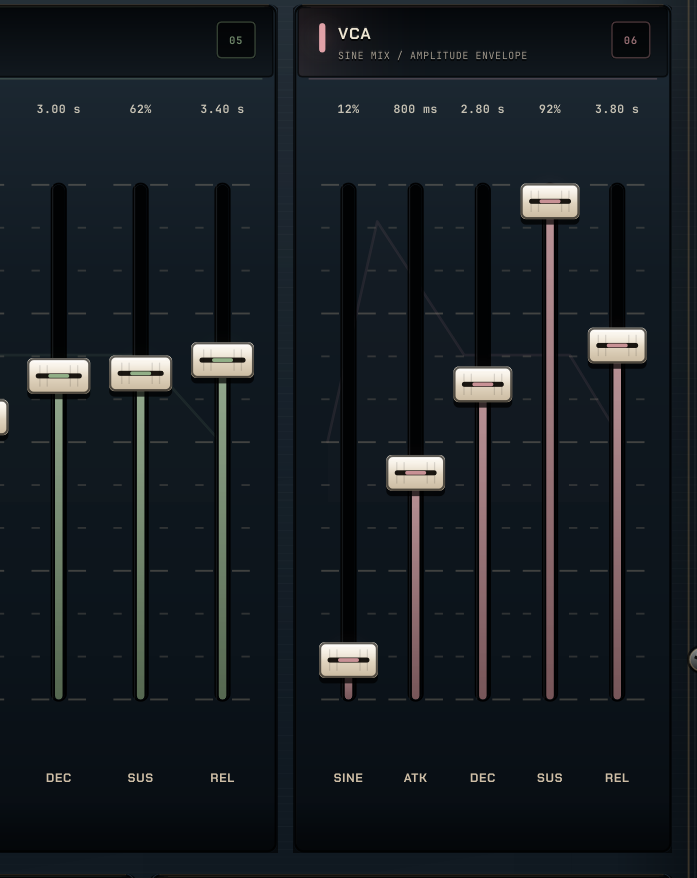
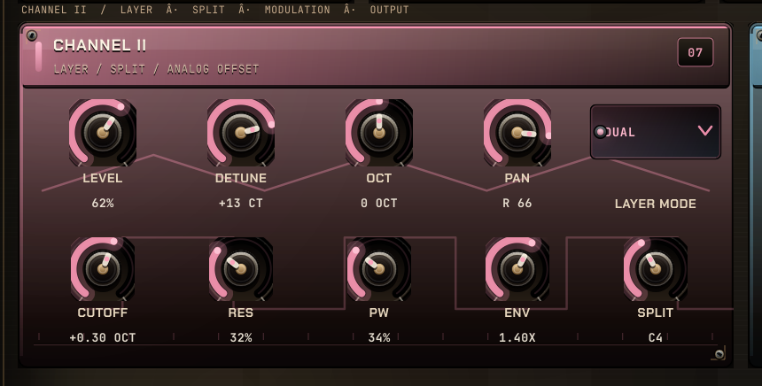
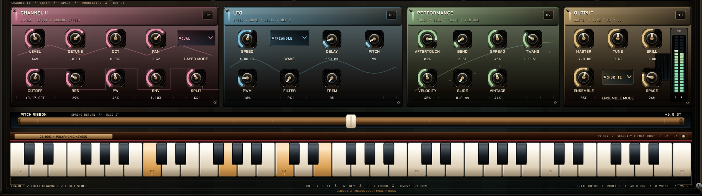
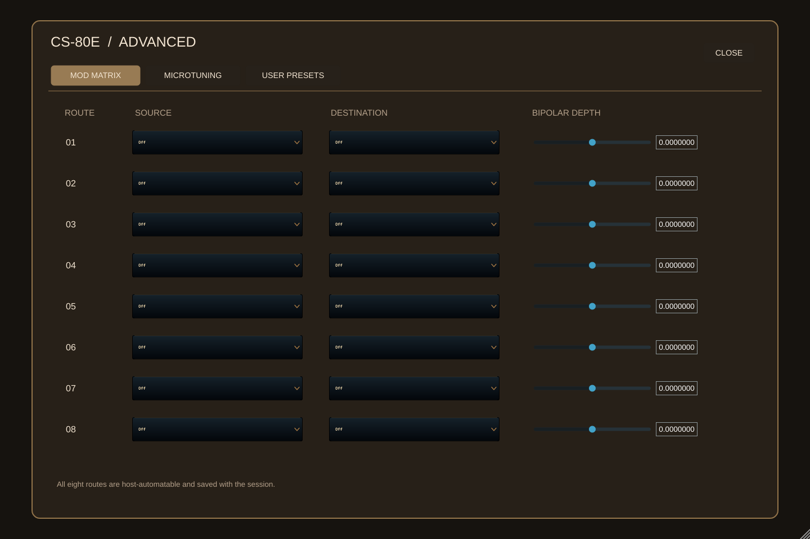
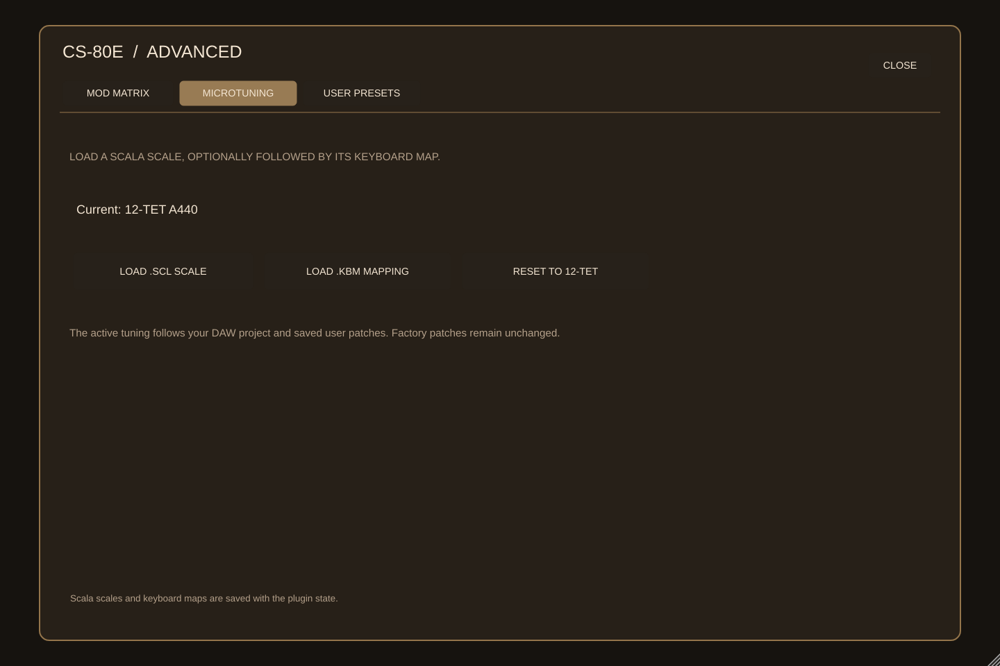
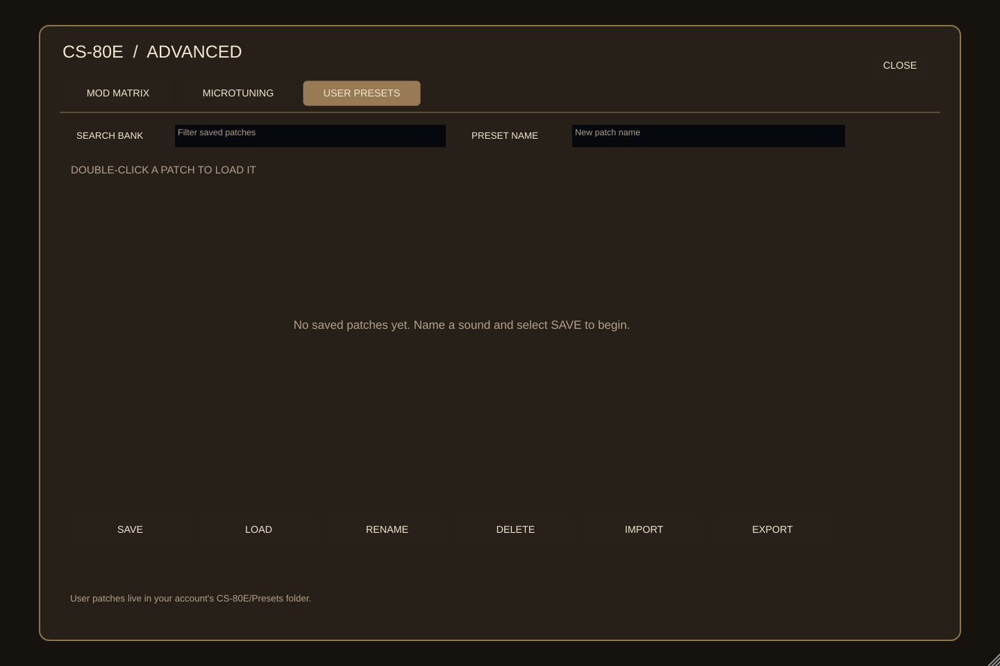

# CS-80E

### A dual-channel, eight-voice CS-80 tribute — VST3 / AU / Standalone

[](https://github.com/boop-bip80/synth1/actions/workflows/ci.yml)
[](https://github.com/boop-bip80/synth1/releases/latest)
[](LICENSE)


<p align="center">
  
</p>

CS-80E is a from-scratch polyphonic synthesizer written in C++17 with JUCE. The
sound is a deliberately characterful take on the Yamaha CS-80 voice: two
independent channel cards, two band-limited oscillators per card, a sub-octave,
a dedicated ring carrier, a resonant high-pass into a resonant low-pass, the
CS-80's two-level filter envelope, polyphonic aftertouch, polyphonic portamento
and a spring-loaded pitch ribbon.

Version 5.3 makes the performance console practical to personalize. Click
**ADVANCED / MOD** (or press **M**) for eight assignable modulation routes,
Scala `.scl` / `.kbm` microtuning and a searchable user-preset bank with
save/load, rename, delete, import and export. DAW projects and `.cs80e` user
patches preserve tuning as well as the sound. Scala pitches and a concurrent
tuning-publication race have also been corrected.

The 5.2 panel was rebuilt around a
warm lacquer finish: figured walnut cheeks, brass rails, a chrome badge, ten
colour-coded voice cards with calibration rails and slot screws, illuminated
ivory sliders, brushed-metal knobs with jewel arcs, warm amber glass and a
dual-trace phosphor scope. The CS-80's chorus/tremolo switch now has its three
authentic positions — Chorus I, Chorus II and Tremolo — and the factory bank
uses them. No bitmap skin, no external editor dependency.

The engine remains the validated 5.1 signal path: quarter-octave band-limited
wavetable mip maps, measured worst-case aliasing at −66 dB (48 kHz), true
8-sample latency reporting, effects that cannot replay stale audio, and zero
heap allocations in the audio callback. Eight voices with both channels and
both effects measure 15.0 % of one core at 48 kHz / 256 frames (0.150× real
time) on the documented reference machine. The 5.3 headless suite is **5,255
checks**, all passing in a local C++17 run; see
[docs/DSP_VALIDATION.md](docs/DSP_VALIDATION.md) and
[docs/BENCHMARKS.md](docs/BENCHMARKS.md).

---

## Download the builds

**Source version: 5.3.0.** The links below point to the rolling `latest`
release, which CI updates from `main` **only after its gated jobs pass**.
If a build is still running, the latest download can temporarily be older
than the source. Check the `version` and `commit` fields in
[`latest.json`](https://github.com/boop-bip80/synth1/releases/download/latest/latest.json)
before installing, or use the versioned
[`v5.3.0` release](https://github.com/boop-bip80/synth1/releases/tag/v5.3.0)
once its CI publication has completed.

| Platform | Download | Formats |
| --- | --- | --- |
| **Linux** | [CS-80E-linux.zip](https://github.com/boop-bip80/synth1/releases/download/latest/CS-80E-linux.zip) | VST3 + Standalone |
| **macOS** | [CS-80E-macos.zip](https://github.com/boop-bip80/synth1/releases/download/latest/CS-80E-macos.zip) | VST3 + AU + Standalone |
| **Windows** | [CS-80E-windows.zip](https://github.com/boop-bip80/synth1/releases/download/latest/CS-80E-windows.zip) | VST3 + Standalone |
| **Renders + demo** | [CS-80E-previews.zip](https://github.com/boop-bip80/synth1/releases/download/latest/CS-80E-previews.zip) | 13 PNGs + demo WAV |
| **Build manifest** | [latest.json](https://github.com/boop-bip80/synth1/releases/download/latest/latest.json) | JSON |
| **Checksums** | [SHA256SUMS.txt](https://github.com/boop-bip80/synth1/releases/download/latest/SHA256SUMS.txt) | SHA-256 |

Every push to `main` builds Linux, macOS and Windows, runs the headless suite,
renders the panel, validates the Linux and Windows VST3 builds with
[pluginval](https://github.com/Tracktion/pluginval) and the macOS AU with
`auval`, refreshes the rolling **latest** release and writes a `latest.json`
manifest with the current links. The release is then downloaded back and
verified against `docs/`. A `v*` tag also publishes a versioned GitHub Release
with its own `latest.json`.

### Install

- **Linux:** copy `VST3/CS-80E.vst3` to `~/.vst3/` (or run the standalone binary).
- **macOS:** copy `VST3/CS-80E.vst3` to `~/Library/Audio/Plug-Ins/VST3/`,
  `AU/CS-80E.component` to `~/Library/Audio/Plug-Ins/Components/`, or run the
  app from `Standalone/`.
- **Windows:** copy `VST3\CS-80E.vst3` to
  `C:\Program Files\Common Files\VST3\`, or run `Standalone\CS-80E.exe`.

The CI builds are unsigned. On macOS, right-click the plugin/app and choose
**Open** the first time. On Windows, allow the app through SmartScreen.

## Screenshots

| | |
| --- | --- |
|  |  |
|  |  |

<p align="center">
  
</p>

<p align="center">
  
  
</p>

<p align="center">
  
</p>

<p align="center">
  
</p>

### New in 5.3: Advanced panel

| Modulation matrix | Scala tuning |
| --- | --- |
|  |  |



CI renders these from the real editor at up to 2× resolution. On `main` it also
commits the refreshed images and demo back to `docs/`, and attaches them to the
latest release.

## Listen

[**cs80-demo.wav**](docs/audio/cs80-demo.wav) — 23 seconds of dual-channel Blade
Brass chords and aftertouch swells, rendered offline through the real processor
by the screenshot tool.

## What is new in 5.3

- **Modulation matrix on the panel.** Eight routes with ten sources (including
  pressure, velocity, LFO, envelopes and random), eight destinations and bipolar
  depth. All 24 route parameters support host automation and project recall.
- **A personal sound bank.** Save, search, load, rename, delete, import or export
  `.cs80e` patches. A user patch includes its parameter baseline and any Scala
  tuning. The bank lives under the OS account's CS-80E application-data folder.
- **Microtuning controls.** Load `.scl` scale files, optionally add a `.kbm`
  keyboard map and reset to 12-TET. Mappings respect absolute Scala pitches,
  fractional reference frequencies, unassigned keys and the specified keyboard
  range; sessions restore these files' contents without needing the original
  paths.
- **Realtime tuning safety.** A three-slot publication protocol prevents
  rapid tuning changes from overwriting data in the audio callback. A parallel
  render/update regression test covers the handover.
- **13 updated preview views.** The screenshot job now renders and checks the
  Advanced panel alongside the existing performance console and demo audio.

### Previous 5.2 improvements

- **The CS-80 chorus/tremolo switch, in full.** Chorus I is a slower, narrower
  three-tap BBD setting; Chorus II keeps the wide five-tap halo; Tremolo is a
  4.6 Hz stereo amplitude sweep whose depth follows the Ensemble control. The
  two chorus settings use genuinely different delay, rate and gain sets, and
  the tremolo stage is 90° out of phase between channels.
- **A complete performance-console repaint.** Warm lacquered metal, walnut
  cheeks, brass rails and screws, ten saturated voice cards, a chrome badge,
  engraved ivory fader caps, brushed knobs with jewel-value arcs, a warmer
  preset LCD, a darker sound library and a reworked bronze ribbon and keybed.
- **Regression tests for the new modes.** The 5.2 suite grew from 5,176 to 5,229
  checks, including the two chorus tap sets and the tremolo envelope.

### 5.1 engine foundations

- **Band-limited wavetable oscillators.** Quarter-octave mip maps are built
  additively at prepare time with every harmonic below 45 % of the host rate.
  A pulse is the difference of two band-limited saw reads, so narrow PWM is
  band-limited by construction. Worst-case measured alias components: −71 dB for
  a 5 % pulse, −79 dB for a high saw, −66 dB for a maximum-brightness patch.
- **Correct latency reporting.** The 33-tap half-band decimator adds 8 host
  samples of group delay; the plugin now reports exactly that to the host, so
  PDC and offline bounces line up. The value is derived from the filter
  topology, not typed in by hand.
- **Effects that cannot replay stale audio.** Chorus and reverb smooth their
  wet/dry gains per sample, keep processing through a real tail, and clear their
  buffers once the tail is gone. Re-enabling after silence measures 0.000000
  peak instead of a burst.
- **A real voice-stealing test.** Eight held voices plus a ninth now genuinely
  force the steal path, with coverage for attack, decay, sustain, release, the
  sustain pedal, dual layers, high resonance/drive, poly pressure and 500 rapid
  retriggers. The hand-over is a 64-sample raised cosine.
- **No allocations in the callback.** FIR coefficients and wavetables are built
  in `prepare()`. The suite counts allocations over 400 callbacks with MIDI and
  parameter changes: zero.
- **Committed measurements.** `docs/benchmarks/` holds raw before/after runs;
  `docs/DSP_VALIDATION.md` documents the method, the numbers and the parts that
  are still unverified.
- **Honest UI pass.** Sub-8 px legends were lifted and secondary contrast
  increased. A full responsive re-layout is still open and is not claimed.

## What is inside

- **Eight-voice polyphony** with oldest-voice stealing, a 64-sample raised
  cosine hand-over, sustain-pedal handling and explicit note ownership, so a
  note-off for a stolen note cannot release its replacement.
- **Dual channel cards** with independent level, octave, detune, pulse width,
  cutoff offset, resonance, envelope scale and pan.
- **Single / Dual / Split** channel modes, with a 36–96 split point.
- **Living voices:** every voice starts at a scattered phase, drifts a few cents
  at its own slow rate and has its own cutoff, level and envelope variance, so
  stacked chords breathe instead of phase-locking into one giant comb filter.
- **2× oversampled voice path:** the oscillators, both filters, the drive stage
  and the VCA curve run at twice the host rate into a 33-tap half-band
  decimator. That path adds exactly 8 host samples of latency, which is
  reported to the host. The oscillator tables themselves are limited to 45 % of
  the host rate so nothing above Nyquist reaches the decimator's transition band.
- **VCO 1:** band-limited wavetable saw, sub-octave square, ±2 octave switch,
  detune.
- **VCO 2:** band-limited wavetable pulse with DC-correct PWM, ±2 octave switch,
  detune.
- **Dedicated ring carrier** (VCO × sine) with speed control, plus a noise
  source.
- **12 dB/oct high-pass and low-pass** filters in series, each resonant, with
  key tracking, an anti-aliased drive stage and a gently saturating low-pass
  core.
- **CS-80-style filter envelope** with Initial Level, Attack Level, A/D/S/R
  and a calibrated sweep depth control.
- **Sine mix** that bypasses the filter and feeds the VCA, plus the amplitude
  ADSR, velocity that opens the filter as well as the VCA, and a transparent
  output limiter.
- **Polyphonic glide** from the last played note, plus master tune and per-voice
  vintage variance.
- **Buffer-size independence:** every glide is time-based and the filters and LFO
  update every eight samples, so the instrument sounds the same at any host
  block size.
- **LFO** (triangle / sine / square / saw) with delay and routings to pitch, PWM,
  filter and tremolo.
- **Expression:** channel and polyphonic aftertouch, mod wheel, pitch bend, a
  spring-loaded ribbon (±12 semitones) and a 61-key poly-touch keybed.
- **Three-position CS-80 ensemble** — Chorus I (three slow taps), Chorus II
  (five wide taps) and stereo Tremolo — with cubic delay reads, a
  stereo-pre-delayed plate reverb, a brilliance tilt and a fixed output
  transformer. Both effects have per-sample wet/dry smoothing, real tails and a
  clean cold-start, so automating them cannot replay stale audio.
- **36 factory patches** plus a searchable personal preset bank with
  save/load, rename, delete, import and export. The preset baseline is stored
  with the project state, so a tweaked patch still reads as edited after the
  project is reopened.
- **Resizable UI** that keeps its hardware proportions from 1080×720 upward.
  Small legends were raised and secondary contrast improved in 5.1; a second
  compact layout is still on the open list.

### The panel

| Section | What it does |
| --- | --- |
| **VCO 1 / VCO 2** | Mix saw/pulse and sub, set pulse width, switch octaves, detune. |
| **RING** | Blend the ring carrier and noise, set the carrier speed. |
| **FILTER** | HPF and LPF cutoffs, resonances, drive and keyboard tracking. |
| **FILTER EG** | IL/AL set the envelope's start and peak; A/D/S/R shape it, DEPTH scales the sweep. |
| **VCA** | Sine mix (post-filter), then the amplitude ADSR. |
| **CHANNEL II** | Layer level, detune, octave, pan, cutoff, resonance, pulse width, envelope scale, mode and split point. |
| **LFO** | Speed, waveform, fade-in delay, and four modulation depths. |
| **PERFORMANCE** | Aftertouch, bend range, stereo spread, initial-bend twang, velocity, glide and vintage. |
| **OUTPUT** | Master, tune, brilliance, Chorus I/II/Tremolo, ensemble depth and space, with a stereo meter. |
| **RIBBON** | Drag left/right for pitch; release to spring back. |
| **KEYBED** | 61 keys, velocity from the vertical touch point, poly pressure from a held drag. |
| **LCD / LIBRARY** | Previous/next patch arrows; click the glass for the 36-patch library. |
| **ADVANCED / MOD** | Eight modulation routes; `.scl` / `.kbm` microtuning; searchable saved-patch bank. Press **M** to open; **Esc** to close. |

## How the CI works

| Job | What it proves |
| --- | --- |
| `dsp-tests` | The engine builds and passes all headless checks without JUCE. |
| `analysis` | The suite plus `cs80_analysis bench/alias/latency`; logs are uploaded as build evidence. |
| `sanitizers` | The same suite under AddressSanitizer and UndefinedBehaviorSanitizer. |
| `version-check` | `VERSION`, the CMake project version and a `v*` tag must agree. |
| `build` | VST3 + Standalone compile on Linux, macOS and Windows (AU also on macOS); the macOS AU is validated with `auval`; tests pass; zips are downloadable. |
| `screenshots` | The real editor is rendered offscreen to 13 PNGs plus a demo WAV; refreshed renders are committed back to `main`. |
| `pluginval` | The Linux and Windows VST3 builds are validated by pluginval at strictness level 5. |
| `publish-latest` | Linux, macOS and Windows zips, checksums, `latest.json` and 13 previews are attached to the rolling `latest` release only after the version, test, analysis, sanitizer, build, render and validation jobs succeed. |
| `verify-latest` | The published rolling assets are downloaded back and checked against `docs/`, `SHA256SUMS.txt` and `latest.json`. |
| `release` | A `v*` tag publishes a versioned GitHub Release with all platform zips, renders, checksums and a versioned `latest.json`. |
| `verify-tagged-release` | The same integrity check runs against the versioned release. |

Screenshots are generated by `Cs80Screenshots`, which instantiates the actual
plugin processor and editor, plays chords through the real MIDI path, and snaps
the component tree. Fonts are embedded, so the renderer is deterministic and
needs no system font packages.

## Build locally

Requirements: **CMake 3.22+**, a **C++17** compiler, and network access the first
time so CMake can fetch JUCE 8.

```bash
# Linux dependencies (Ubuntu/Debian)
sudo apt-get install -y build-essential cmake \
  libasound2-dev libx11-dev libxext-dev libxrandr-dev libxinerama-dev \
  libxcursor-dev libfreetype-dev libfontconfig1-dev libgl1-mesa-dev

cmake -S . -B build -DCMAKE_BUILD_TYPE=Release
cmake --build build --config Release --parallel

# Headless DSP suite
ctest --test-dir build -C Release --output-on-failure

# Panel screenshots + demo audio
./build/tools/Cs80Screenshots_artefacts/Release/Cs80Screenshots docs
```

Useful options:

```bash
-DCS80_BUILD_PLUGIN=OFF   # engine + tests only (no JUCE download)
-DCS80_BUILD_TOOLS=OFF    # plugin only, skip the offline renderer
-DCS80_BUILD_TESTS=OFF    # skip the unit test executable
```

The plugin targets are written to
`build/src/plugin/Cs80Plugin_artefacts/Release/`.

## Architecture

```
src/dsp/            Pure C++17 engine — no JUCE, fully unit-testable
  Params.*            parameter table + POD snapshot
  Dsp.h               polyBLEP oscillators, ADAA drive, nonlinear SVF,
                      segment envelopes
  Engine.*            eight dual-channel voices, glide, modulation, ring carrier,
                      ensemble, stereo-pre-delay plate, transparent limiter
  Presets.*           36 factory patches
  Oscillator.h        band-limited wavetable mip maps + oscillators
  tests/              5,255 headless assertions, FFT alias analysis

src/plugin/         JUCE wrapper
  PluginProcessor.*   APVTS, presets, MIDI dispatch, state persistence
  PluginEditor.*      panel layout and preset library wiring
  ui/                 theme, look and feel, hardware controls, dual scope,
                      meters, ribbon, 61-key poly-touch keybed and preset browser

tools/screenshot/   Offline editor renderer + demo WAV
tools/analysis/     CPU, aliasing and latency measurement tool
.github/workflows/  Build, test, analysis, sanitizer, screenshot, pluginval and release pipeline
assets/fonts/       Embedded Chakra Petch, JetBrains Mono and Michroma (OFL)
docs/               Screenshots, demo, validation, benchmarks and the quality register
```

Designed boundaries: the engine never includes JUCE, so the full signal path can
run in a plain test binary on every platform. The JUCE layer only translates
parameters, MIDI and state, and paints the panel.

## Tests

The headless suite covers:

- parameter table integrity, ranges, defaults and every spec↔struct mapping;
- preset application, uniqueness and clamping across all 36 patches;
- silence when idle; finite output at every parameter extreme;
- 8-voice polyphony with a ninth note genuinely stealing the oldest voice,
  across attack/decay/sustain/release, pedal, dual layers, drive and pressure;
- note-off ownership after a steal, 500 rapid retriggers and repeated pitches;
- decimator impulse delay (8 host samples), reported latency and unity DC gain;
- FFT alias gates at 48 kHz for saws, narrow pulse, sub octave and max brightness;
- direct SVF gain at cutoff, resonance peak, and stability at 44.1–192 kHz, Q 40;
- envelope attack/decay/release timing measured in samples;
- chorus/reverb re-enable after silence (no stale burst) and smooth live toggles;
- distinct Chorus I and Chorus II tap sets plus a measured tremolo envelope;
- zero heap allocations across 400 callbacks with MIDI and parameter changes;
- dual-channel layering, keyboard splits, layer panning and the ring carrier;
- sub-oscillator tracking, polyphonic glide, master tune and vintage spread;
- sine-mix bypass level, initial-bend decay and independent card drift;
- identical rendering at 32- and 512-sample host block sizes;
- A4 tuning and repeated prepare at 44.1, 48, 88.2, 96 and 192 kHz;
- high drive/resonance stability, sustain pedal, aftertouch/mod wheel and
  deterministic renders;
- every factory preset rendering with sane peak levels.

CI builds the plugin on three operating systems, runs the suite and the
`cs80_analysis` benchmark/alias/latency tool, runs ASan+UBSan, validates the
Linux and Windows VST3 builds with pluginval
(`--strictness-level 5 --skip-gui-tests`), and validates the macOS AU with
`auval`. These are automated validators, not a DAW compatibility matrix.

## Known limitations

- No user preset manager (save/rename/import/export/search) in 5.1. Factory
  presets, DAW state and the edited indicator work; user banks do not exist yet.
- No modulation matrix, microtuning/`.scl` import, MPE zones or MIDI learn in
  5.1. Channel pressure, poly pressure, mod wheel, bend and sustain do work.
- No DAW compatibility matrix has been produced. pluginval and `auval` are
  automated validators and do not prove compatibility with every host.
- No comparison against physical CS-80 hardware was performed. The filter and
  voice are musical approximations, not circuit models.
- CI builds are unsigned. macOS requires right-click → Open the first time;
  Windows SmartScreen will warn.
- The GUI still scales uniformly below its 1440×960 design size instead of
  switching to a second compact layout.
- An eight-slot modulation matrix and Scala `.scl`/`.kbm` microtuning are
  implemented and tested in the engine, but they have **no panel controls and
  no plugin-state persistence yet**, so they are not part of the 5.1 release.
  Do not expect to find them in the UI.

## License

The project is licensed under **AGPL-3.0**. JUCE is used under its AGPLv3
option; see [LICENSE](LICENSE) and the [JUCE licensing page](https://juce.com/legal/juce-8-licence/).

Bundled fonts (Chakra Petch, JetBrains Mono, Michroma) are under the SIL Open
Font License 1.1; see [assets/fonts/OFL.txt](assets/fonts/OFL.txt).

CS-80 is a trademark of Yamaha Corporation. **CS-80E is an unofficial tribute and
is not affiliated with or endorsed by Yamaha.** All sound generation and UI
painting here is original code.

---

Built with C++17, JUCE 8, CMake and GitHub Actions.
