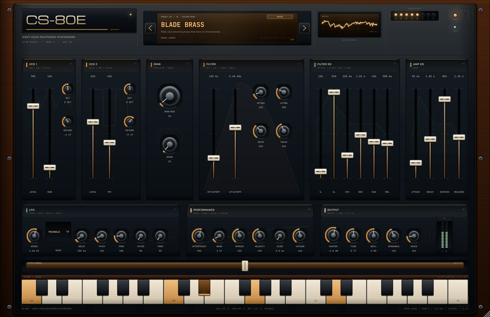
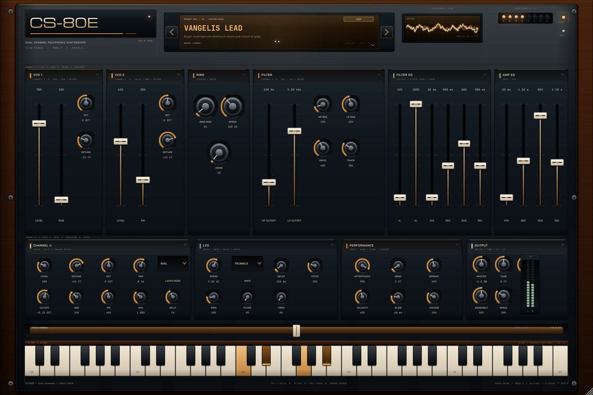
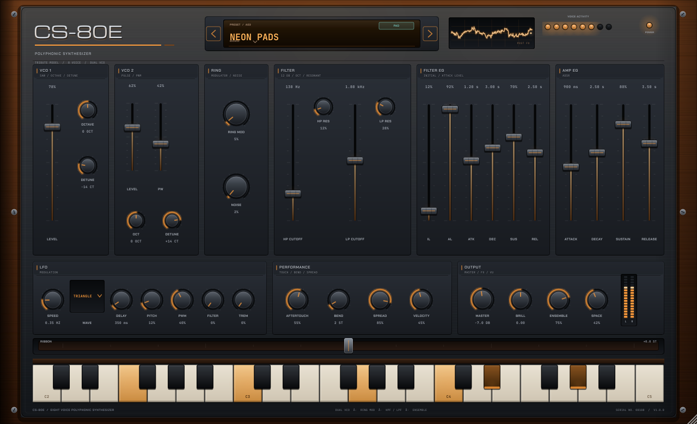
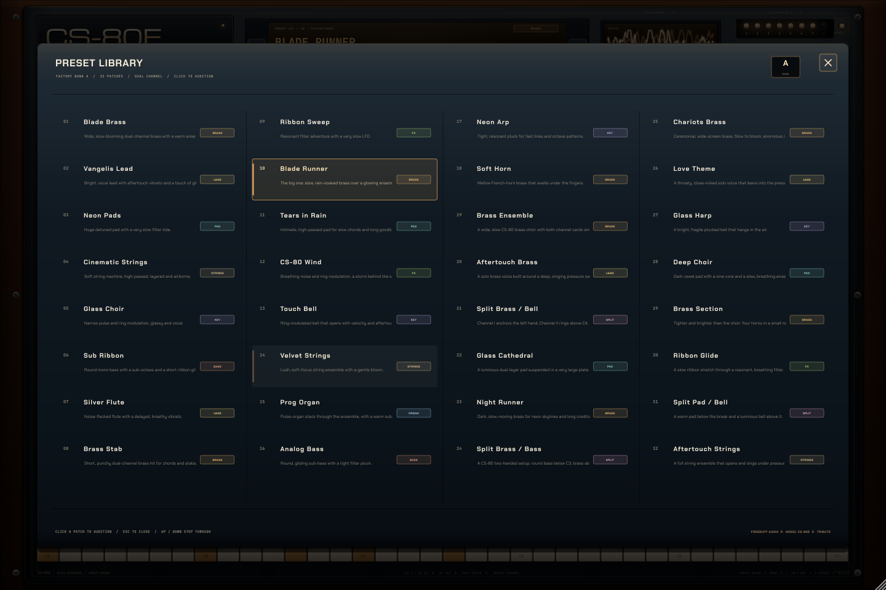
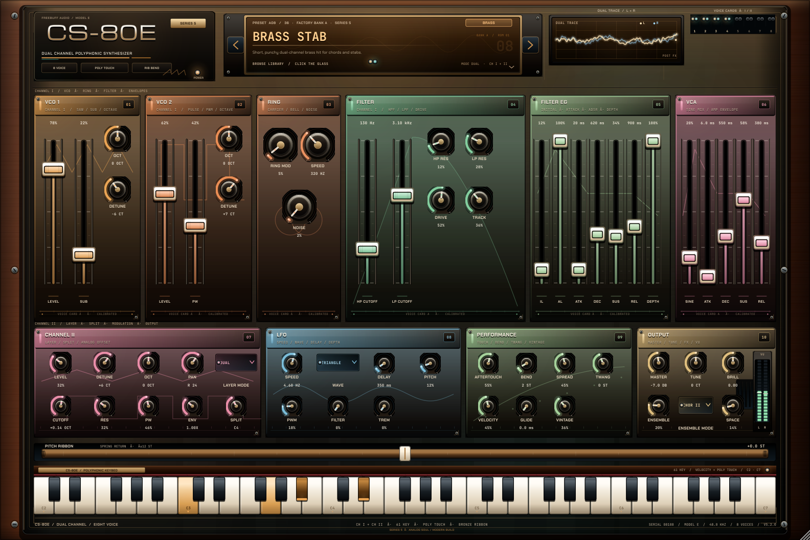
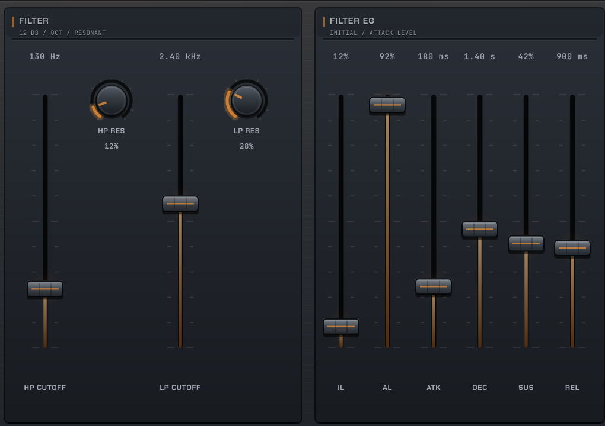

# CS-80E

### An eight-voice, dual-VCO CS-80 tribute — VST3 / AU / Standalone

[](https://github.com/boop-bip80/synth1/actions/workflows/ci.yml)
[](LICENSE)


<p align="center">
  
</p>

CS-80E is a from-scratch polyphonic synthesizer written in C++17 with JUCE. The
sound is a deliberately characterful take on the Yamaha CS-80 voice: two
band-limited oscillators, a ring modulator, a resonant high-pass into a resonant
low-pass, the CS-80's two-level filter envelope, polyphonic aftertouch and a
spring-loaded pitch ribbon.

The entire panel is painted in code — brushed aluminium, walnut cheeks, engraved
lettering, amber LEDs, a warm LCD and a phosphor scope. No bitmap skin, no
external editor dependency.

---

## Screenshots

| | |
| --- | --- |
|  |  |
|  |  |

<p align="center">
  
</p>

## Download the builds

Every push builds the plugin on Linux, macOS and Windows, runs the test suite,
renders the screenshots above and validates the VST3 with
[pluginval](https://github.com/Tracktion/pluginval). The binaries are attached to
the workflow run:

1. Open the [**Actions**](https://github.com/boop-bip80/synth1/actions) tab and pick
   the latest **CI** run.
2. Download `CS-80E-linux.zip`, `CS-80E-macos.zip` or `CS-80E-windows.zip` from
   **Artifacts**.
3. Unzip and install:
   - **Linux:** copy `VST3/CS-80E.vst3` to `~/.vst3/` (or run the standalone).
   - **macOS:** copy `VST3/CS-80E.vst3` to `~/Library/Audio/Plug-Ins/VST3/` and
     `AU/CS-80E.component` to `~/Library/Audio/Plug-Ins/Components/`.
   - **Windows:** copy `VST3\CS-80E.vst3` to
     `C:\Program Files\Common Files\VST3\`.

The `CS-80E-previews` artifact contains the six panel renders and
[`cs80-demo.wav`](docs/audio/cs80-demo.wav).

Pushing a `v*` tag also publishes a GitHub **Release** with all three platform
zips plus the preview bundle.

> The CI builds are unsigned. On macOS, right-click the plugin/app and choose
> **Open** the first time. On Windows, allow the app through SmartScreen.

## Listen

[**cs80-demo.wav**](docs/audio/cs80-demo.wav) — 18 seconds of Blade Brass chords,
rendered offline through the real processor by the screenshot tool.

## What is inside

- **8-voice polyphony** with click-free oldest-voice stealing and sustain-pedal
  handling: a robbed voice keeps its oscillator phase and filter state and
  re-arms its envelopes from wherever they are.
- **Living voices:** every voice starts at a scattered phase and drifts a few
  cents at its own slow rate, so stacked chords breathe instead of phase-locking
  into one giant comb filter.
- **VCO 1:** band-limited polyBLEP saw, ±2 octave switch, detune.
- **VCO 2:** polyBLEP pulse with PWM, ±2 octave switch, detune.
- **Ring modulator** (VCO1 × VCO2) plus a noise source.
- **12 dB/oct high-pass and low-pass** filters in series, each resonant, with
  the low-pass core gently overdriven the way a CS-80's is.
- **CS-80-style filter envelope** with Initial Level, Attack Level and A/D/S/R.
- **Amplitude ADSR**, velocity that opens the filter as well as the VCA, and a
  soft output limiter.
- **Buffer-size independence:** every glide is time-based and the filters and LFO
  update every eight samples, so the instrument sounds the same at any host
  block size.
- **LFO** (triangle / sine / square / saw) with delay and routings to pitch, PWM,
  filter and tremolo.
- **Expression:** channel and polyphonic aftertouch, mod wheel, pitch bend and a
  spring-loaded ribbon (±12 semitones) that you can play with the mouse.
- **Ensemble chorus**, plate reverb and a brilliance tilt on the output.
- **9 factory patches**, a pull-down preset library, tooltips and double-click
  parameter reset.
- **Resizable UI** that keeps its hardware proportions from 960×585 upward.

### The panel

| Section | What it does |
| --- | --- |
| **VCO 1 / VCO 2** | Mix the saw and pulse, switch octaves, detune up to ±25 cents. |
| **RING** | Blend the ring modulator and noise into the oscillators. |
| **FILTER** | HPF and LPF cutoffs plus resonance, in series. |
| **FILTER EG** | IL/AL set the envelope's start and peak; A/D/S/R shape it. |
| **AMP EG** | Straight ADSR for the VCA. |
| **LFO** | Speed, waveform, fade-in delay, and four modulation depths. |
| **PERFORMANCE** | Aftertouch depth, bend range, stereo spread and velocity sensitivity. |
| **OUTPUT** | Master, brilliance, ensemble and space, with a segmented stereo meter. |
| **RIBBON** | Drag left/right for pitch; release to spring back. |
| **KEYBED** | Three octaves, velocity from the vertical touch point. |
| **LCD** | Previous/next patch arrows; click the glass to open the library. |

## How the CI works

| Job | What it proves |
| --- | --- |
| `dsp-tests` | The engine builds and passes all headless checks without JUCE. |
| `build` | VST3 + Standalone compile on Linux, macOS and Windows (AU also on macOS); tests pass; zips are downloadable. |
| `screenshots` | The real editor is rendered offscreen to six PNGs plus a demo WAV. |
| `pluginval` | The Linux VST3 is validated by pluginval at strictness level 5. |
| `release` | Tagged builds and previews are attached to a GitHub Release. |

Screenshots are generated by `Cs80Screenshots`, which instantiates the actual
plugin processor and editor, plays chords through the real MIDI path, and snaps
the component tree. Fonts are embedded, so the renderer is deterministic and
needs no system font packages.

## Build locally

Requirements: **CMake 3.22+**, a **C++17** compiler, and network access the first
time so CMake can fetch JUCE 8.

```bash
# Linux dependencies (Ubuntu/Debian)
sudo apt-get install -y build-essential cmake \
  libasound2-dev libx11-dev libxext-dev libxrandr-dev libxinerama-dev \
  libxcursor-dev libfreetype-dev libfontconfig1-dev libgl1-mesa-dev

cmake -S . -B build -DCMAKE_BUILD_TYPE=Release
cmake --build build --config Release --parallel

# Headless DSP suite
ctest --test-dir build -C Release --output-on-failure

# Panel screenshots + demo audio
./build/tools/Cs80Screenshots_artefacts/Release/Cs80Screenshots docs
```

Useful options:

```bash
-DCS80_BUILD_PLUGIN=OFF   # engine + tests only (no JUCE download)
-DCS80_BUILD_TOOLS=OFF    # plugin only, skip the offline renderer
-DCS80_BUILD_TESTS=OFF    # skip the unit test executable
```

The plugin targets are written to
`build/src/plugin/Cs80Plugin_artefacts/Release/`.

## Architecture

```
src/dsp/            Pure C++17 engine — no JUCE, fully unit-testable
  Params.*            parameter table + POD snapshot
  Dsp.h               polyBLEP oscillator, TPT SVF, multi-stage envelope
  Engine.*            8 voices, modulation, ensemble, plate reverb, master
  Presets.*           9 factory patches
  tests/              927 headless assertions

src/plugin/         JUCE wrapper
  PluginProcessor.*   APVTS, presets, MIDI dispatch, state persistence
  PluginEditor.*      panel layout and preset library wiring
  ui/                 theme, look and feel, hardware controls, scope,
                      meters, ribbon, keybed and preset browser

tools/screenshot/   Offline editor renderer + demo WAV
.github/workflows/  Build, test, screenshot, pluginval and release pipeline
assets/fonts/       Embedded Chakra Petch, JetBrains Mono and Michroma (OFL)
docs/               Committed screenshots and the demo render
```

Designed boundaries: the engine never includes JUCE, so the full signal path can
run in a plain test binary on every platform. The JUCE layer only translates
parameters, MIDI and state, and paints the panel.

## Tests

The headless suite covers:

- parameter table integrity, ranges, defaults and every spec↔struct mapping;
- preset application, uniqueness and clamping;
- silence when idle; finite output at every parameter extreme;
- 8-voice polyphony, click-free voice stealing and velocity-opened filters;
- identical rendering at 32- and 512-sample host block sizes;
- A4 tuning at 44.1, 48 and 96 kHz, octave switches and 24-semitone bend;
- filter brightness response, ring/chorus stereo behaviour and reverb decay;
- sustain pedal, retriggering, aftertouch/mod wheel and deterministic renders;
- every factory preset rendering with sane peak levels.

CI additionally builds the plugin on three operating systems and validates the
Linux VST3 with pluginval (`--strictness-level 5 --skip-gui-tests`).

## License

The project is licensed under **AGPL-3.0**. JUCE is used under its AGPLv3
option; see [LICENSE](LICENSE) and the [JUCE licensing page](https://juce.com/legal/juce-8-licence/).

Bundled fonts (Chakra Petch, JetBrains Mono, Michroma) are under the SIL Open
Font License 1.1; see [assets/fonts/OFL.txt](assets/fonts/OFL.txt).

CS-80 is a trademark of Yamaha Corporation. **CS-80E is an unofficial tribute and
is not affiliated with or endorsed by Yamaha.** All sound generation and UI
painting here is original code.

---

Built with C++17, JUCE 8, CMake and GitHub Actions.
